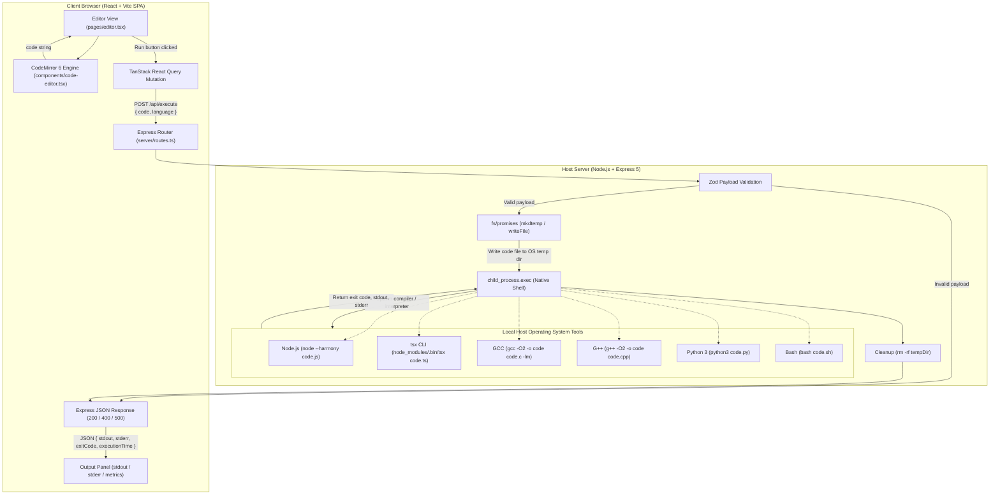
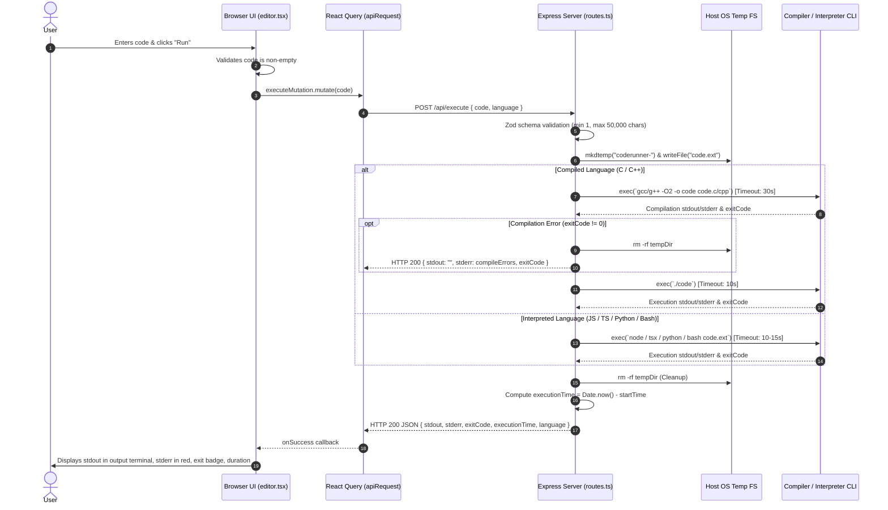
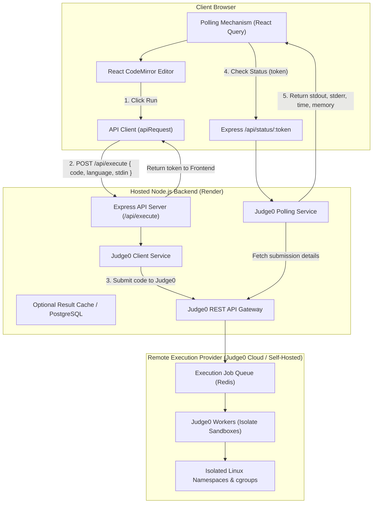
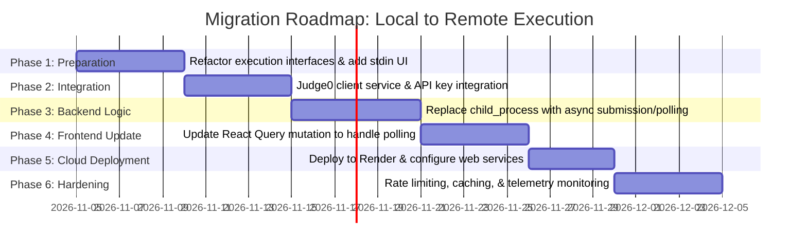

# Technical Architecture: Online Compiler (CodeRunner)

This document provides an exhaustive technical analysis of the current implementation of **Online Compiler** (CodeRunner), its system architecture, code execution mechanics, security limitations, and a comprehensive proposed architecture and phased roadmap for migrating to a secure, remote code execution system using Judge0 and Render.

---

## Table of Contents

- [1. System Overview](#1-system-overview)
- [2. Technology Stack](#2-technology-stack)
- [3. Project Directory Structure](#3-project-directory-structure)
- [4. Current Architecture Diagram](#4-current-architecture-diagram)
- [5. Current Code Execution Lifecycle](#5-current-code-execution-lifecycle)
- [6. Frontend Architecture](#6-frontend-architecture)
- [7. Backend Architecture](#7-backend-architecture)
- [8. API Documentation](#8-api-documentation)
- [9. Language Execution Configuration](#9-language-execution-configuration)
- [10. Input and Output Handling](#10-input-and-output-handling)
- [11. Environment and Deployment](#11-environment-and-deployment)
- [12. Current Limitations & Risk Assessment](#12-current-limitations--risk-assessment)
- [13. Planned Architecture: Remote Code Execution (Judge0)](#13-planned-architecture-remote-code-execution-judge0)
- [14. Migration Roadmap](#14-migration-roadmap)
- [15. Verification & Architectural Decision Items](#15-verification--architectural-decision-items)

---

## 1. System Overview

Online Compiler is an integrated full-stack web application designed for browser-based code editing and execution. It currently functions as a **monolithic single-process architecture** where an Express.js backend serves both the Single Page Application (SPA) frontend and the REST API endpoints.

In the current development implementation:
1. The user writes code in an in-browser code editor built on CodeMirror 6.
2. When the user initiates code execution, the client dispatches an HTTP POST request containing source code and a language identifier to `/api/execute`.
3. The Express backend receives the payload, writes the code to a temporary filesystem directory on the host machine, and spawns native child processes (`node`, `gcc`, `g++`, `python3`, `bash`) via `child_process.exec`.
4. Outputs (`stdout`), errors (`stderr`), and status codes are captured and returned synchronously over HTTP JSON to the browser.
5. The temporary folder is purged, and the frontend renders results in the output terminal panel.

> **Target Goal**: This architecture currently couples execution directly to the server host's operating system environment. A future phase aims to decouple execution into an isolated remote sandbox environment (such as Judge0 hosted separately) without requiring users or the primary web host to maintain native compiler installations.

---

## 2. Technology Stack

### 2.1 Frontend Stack

| Technology | Package / Version | Role & Responsibilities |
| :--- | :--- | :--- |
| **React** | `react@^18.3.1`, `react-dom@^18.3.1` | Core UI library for reactive component tree and view state. |
| **TypeScript** | `typescript@5.x` | Static typing across components, models, and execution schemas. |
| **Vite** | `vite@^5.x` / `@tailwindcss/vite` | Next-generation frontend bundler, HMR dev server, and build tool. |
| **Code Editor** | `codemirror@^6.0.2` | Core extensible code editor engine. |
| **Editor Extensions** | `@codemirror/lang-cpp`, `@codemirror/lang-javascript`, `@codemirror/lang-python`, `@codemirror/legacy-modes`, `@codemirror/theme-one-dark` | Syntax highlighting, language syntax grammars, dark theme tokenization. |
| **Routing** | `wouter@^3.3.5` | Minimalist browser hashless routing (`/`, `/c`, `/cpp`, `/python`, `/bash`, `/snippets`, `/settings`). |
| **Data Fetching** | `@tanstack/react-query@^5.60.5` | Mutation management, async loading state, and error handling for code execution. |
| **UI Components** | Radix UI primitives (`@radix-ui/react-*`), `shadcn/ui` style | Accessible dialogs, tooltips, sidebars, dropdowns, buttons, and scroll areas. |
| **Styling** | `tailwindcss@^4.x`, `tailwind-merge`, `clsx`, `tailwindcss-animate` | Utility-first styling with CSS custom variables for theme toggles. |
| **Icons** | `lucide-react@^0.453.0`, `react-icons@^5.4.0` | Vector icons across sidebar, toolbar, and status badges. |

### 2.2 Backend Stack

| Technology | Package / Version | Role & Responsibilities |
| :--- | :--- | :--- |
| **Node.js Runtime** | Node 20+ (ES Modules) | High-performance server-side JavaScript runtime. |
| **Web Server** | `express@^5.0.1`, `http` | HTTP server providing request routing, static file serving, and middleware. |
| **Process Execution** | Node.js `child_process` (`exec`) | Spawns operating system sub-shells to invoke compilers and binaries. |
| **Filesystem Management** | Node.js `fs/promises`, `path`, `os` | Creates isolated temporary working directories (`mkdtemp`) and code source files. |
| **Validation Engine** | `zod@^3.24.2` | Validates API request payloads (`code` string constraints and allowed `language` enums). |
| **Server Bundler** | `esbuild@^0.25.0` | Compiles and bundles `server/index.ts` into a production CommonJS bundle (`dist/index.cjs`). |
| **Data Scaffold (Unused)** | `drizzle-orm@^0.39.3`, `pg@^8.16.3` | Database schema scaffolding and PostgreSQL client (currently unused for code execution). |
| **In-Memory Store** | `MemStorage` (`server/storage.ts`) | Fallback storage interface for mock user entities. |

---

## 3. Project Directory Structure

```
Online-Compiler/
├── client/                          # Frontend React SPA
│   ├── index.html                   # HTML entrypoint for Vite
│   ├── public/                      # Static client assets (favicon.png)
│   └── src/
│       ├── main.tsx                 # React DOM root hydration
│       ├── App.tsx                  # Root application, routes, language presets
│       ├── index.css                # Global Tailwind CSS and design tokens
│       ├── components/              # Shared UI components
│       │   ├── app-sidebar.tsx      # Sidebar navigation & language switcher
│       │   ├── code-editor.tsx      # CodeMirror 6 wrapper component
│       │   ├── theme-toggle.tsx     # Light/Dark mode switcher button
│       │   └── ui/                  # Radix UI / Shadcn UI primitives
│       ├── hooks/                   # Custom React hooks
│       │   ├── use-theme.ts         # Dark/Light theme switching & persistence
│       │   ├── use-toast.ts         # Toast notification state hook
│       │   └── use-mobile.tsx       # Viewport breakpoint detection
│       ├── lib/                     # Frontend client utilities
│       │   ├── queryClient.ts       # TanStack Query client & apiRequest wrapper
│       │   └── utils.ts             # Tailwind className merger (cn helper)
│       └── pages/                   # Application route views
│           ├── editor.tsx           # Primary IDE page (Editor, Output panel, Toolbar)
│           ├── snippets.tsx         # Predefined code examples library
│           ├── settings.tsx         # Environment overview & theme controls
│           └── not-found.tsx        # 404 fallback page
├── server/                          # Backend Express Application
│   ├── index.ts                     # Server initialization, logging middleware, Vite/Static config
│   ├── routes.ts                    # REST API route handlers & compilation/execution logic
│   ├── static.ts                    # Production static file serving for dist/public
│   ├── vite.ts                      # Development Vite middleware integration
│   └── storage.ts                   # In-memory user data storage interface (IStorage / MemStorage)
├── shared/                          # Shared models and schemas
│   └── schema.ts                    # Drizzle ORM user definitions & Zod validation schemas
├── script/                          # Build and automation scripts
│   └── build.ts                     # Production build orchestration (Vite build + esbuild server)
├── .replit / replit.nix             # Nix package dependencies & Replit environment config
├── drizzle.config.ts                # Drizzle ORM database migration configuration
├── components.json                  # Shadcn UI configuration file
├── package.json                     # Project manifest, dependencies, and execution scripts
├── tailwind.config.ts               # Tailwind CSS theme styling configuration
├── tsconfig.json                    # TypeScript compiler options & module resolution paths
├── README.md                        # User-facing project documentation
└── ARCHITECTURE.md                  # This technical architectural reference
```

---

## 4. Current Architecture Diagram

The diagram below reflects the **current, actual implementation** of the codebase:



---

## 5. Current Code Execution Lifecycle

When a user opens the application and clicks **Run**, the synchronous execution lifecycle executes through the following stages:



---

## 6. Frontend Architecture

### 6.1 Component Hierarchy
- `App.tsx`: Top-level router managing the page shell, `SidebarProvider`, and `Wouter` routes. Injects the `LANGUAGES` configuration dictionary.
- `AppSidebar`: Navigation drawer displaying supported language tabs (`/`, `/c`, `/cpp`, `/python`, `/bash`), resource links (`/snippets`, `/settings`), and language icon badges.
- `EditorPage`: Primary state container for the active editor session. Manages:
  - Source code buffer (`code`).
  - Output execution payload (`output`).
  - Terminal panel height and collapse state.
  - Toolbar actions (Run, Copy, Reset, Download, Clear).
- `CodeEditor`: CodeMirror 6 wrapper component.
  - Houses the CodeMirror `EditorView` mounted into an HTML reference container.
  - Dynamically switches language syntax compartments (`@codemirror/state` `Compartment`).
  - Listens to document theme mutations via `MutationObserver` on `document.documentElement` to toggle between `oneDark` and custom light theme.
- `ThemeToggle`: Switches document root class between `dark` and `light` and stores preference in `localStorage`.

### 6.2 State Management
- **Local View State**: Standard React `useState` hooks manage local UI transient state (active code string, collapsed output panel, copy feedback indicator).
- **Execution State**: Managed via `@tanstack/react-query`'s `useMutation`.
  - `executeMutation.isPending`: Toggles "Running..." UI spinners and disables re-triggering.
  - `executeMutation.data`: Ingests and renders execution results.
  - `executeMutation.onError`: Dispatches toast notifications on network or server 500 crashes.

---

## 7. Backend Architecture

### 7.1 Server Setup & Entrypoint (`server/index.ts`)
- Configures an Express 5 application with `http.createServer`.
- Ingests JSON bodies with a custom verify hook storing `req.rawBody`.
- Injects a request logger middleware recording execution latency and response status for `/api/*` routes.
- Selects the static delivery model:
  - **Development**: Invokes `setupVite(httpServer, app)` from `server/vite.ts`, attaching Vite dev middleware and transforming `client/index.html`.
  - **Production**: Invokes `serveStatic(app)` from `server/static.ts`, serving built files from `dist/public`.

### 7.2 Execution Service (`server/routes.ts`)
The core execution engine is organized into functional helper blocks:
- `runCommand(cmd, timeout)`: Wraps Node.js `child_process.exec` in a `Promise`. Imposes a `maxBuffer` of 1 MB and enforces maximum execution time limits.
- `withTempDir(fn)`: Uses `fs/promises.mkdtemp` within the operating system's temporary directory (`os.tmpdir()`), executes the callback `fn(dir)`, and ensures cleanup via a `finally` block executing `rm -rf "${dir}"`.
- Language-specific handlers: `executeJavaScript`, `executeTypeScript`, `executeC`, `executeCpp`, `executePython`, `executeBash`.

---

## 8. API Documentation

### POST `/api/execute`

Executes user-supplied code synchronously on the server host and returns execution streams and telemetry.

#### Endpoint Specifications
- **Method**: `POST`
- **Path**: `/api/execute`
- **Content-Type**: `application/json`
- **Authentication**: None

#### Request Schema (Zod Validated)
```typescript
{
  code: string;       // Required: Min 1 char, Max 50,000 chars
  language: string;   // Required: One of "javascript" | "typescript" | "c" | "cpp" | "python" | "bash"
}
```

#### Example Request
```json
{
  "language": "cpp",
  "code": "#include <iostream>\nint main() { std::cout << \"Hello World\"; return 0; }"
}
```

#### Success Response: HTTP 200 OK
```json
{
  "stdout": "Hello World",
  "stderr": "",
  "exitCode": 0,
  "executionTime": 412,
  "language": "cpp"
}
```

#### Compilation / Runtime Error Response: HTTP 200 OK
*(Note: Programmatic errors return HTTP 200 with non-zero `exitCode` and captured `stderr`)*
```json
{
  "stdout": "",
  "stderr": "code.cpp:2:1: error: expected ';' before '}' token\n",
  "exitCode": 1,
  "executionTime": 215,
  "language": "cpp"
}
```

#### Client Error Response: HTTP 400 Bad Request
```json
{
  "error": "Invalid request",
  "details": {
    "code": {
      "_errors": ["String must contain at least 1 character(s)"]
    }
  }
}
```

#### Server Error Response: HTTP 500 Internal Server Error
```json
{
  "error": "Execution failed",
  "message": "spawn ENOMEM"
}
```

---

## 9. Language Execution Configuration

The table below documents the exact commands, execution pipelines, and toolchain dependencies for every language in the current implementation:

| Language | Language ID | Compiler / Interpreter | Pipeline Stage 1 (Compile) | Pipeline Stage 2 (Execute) | Timeout Limits | Required Local Installation | Code Reference |
| :--- | :--- | :--- | :--- | :--- | :--- | :--- | :--- |
| **JavaScript** | `javascript` | Node.js | None (Interpreted) | `node --harmony "code.js"` | Execution: 10,000 ms | Node.js v20+ in `PATH` | `server/routes.ts` L37-43 |
| **TypeScript** | `typescript` | `tsx` CLI runner | None (Transpiled in-memory) | `"<cwd>/node_modules/.bin/tsx" "code.ts"` | Execution: 15,000 ms | Project `node_modules` | `server/routes.ts` L45-52 |
| **C** | `c` | GCC (GNU C Compiler) | `gcc -O2 -o "code" "code.c" -lm 2>&1` | `"./code"` | Compile: 30,000 ms<br>Exec: 10,000 ms | `gcc` in system `PATH` | `server/routes.ts` L54-70 |
| **C++** | `cpp` | G++ (GNU C++ Compiler) | `g++ -O2 -o "code" "code.cpp" 2>&1` | `"./code"` | Compile: 30,000 ms<br>Exec: 10,000 ms | `g++` in system `PATH` | `server/routes.ts` L72-88 |
| **Python** | `python` | Python 3 Interpreter | Dynamic check: `which python3 \|\| which python 2>&1` | `<pythonBin> "code.py"` | Check: 3,000 ms<br>Exec: 10,000 ms | `python3` or `python` in `PATH` | `server/routes.ts` L90-107 |
| **Bash** | `bash` | Bash Shell | None (Interpreted script) | `bash "code.sh"` | Execution: 10,000 ms | `bash` in system `PATH` | `server/routes.ts` L109-115 |

---

## 10. Input and Output Handling

### 10.1 Standard Input (`stdin`)
- **Current Status**: **UNSUPPORTED**.
- In `server/routes.ts`, `child_process.exec` is invoked without writing to the spawned process's `stdin` pipe.
- Any program that issues an interactive read (e.g., `cin >> var`, `scanf("%d")`, `input()`, `readline()`) receives no input stream, blocks indefinitely, and is eventually killed when the 10,000 ms timeout triggers.

### 10.2 Standard Output (`stdout`)
- Captured via the `stdout` buffer callback of `child_process.exec`.
- Configured with a `maxBuffer` limit of **1,048,576 bytes (1 MB)**. Exceeding 1 MB causes the process to fail with an error `ERR_CHILD_PROCESS_STDIO_MAXBUFFER`.

### 10.3 Standard Error (`stderr`) & Diagnostics
- Captured via the `stderr` buffer callback.
- In compiled languages (C and C++), the compilation command redirects standard error to standard output via `2>&1` (`gcc -O2 -o "code" "code.c" -lm 2>&1`). If compilation fails (`exitCode !== 0`), the output string is sent back under the `stderr` response field, and execution aborts early.

### 10.4 Execution Telemetry
- `executionTime` is computed using a wall-clock timer (`Date.now() - startTime`) encompassing directory creation, file I/O, compilation, and execution.

---

## 11. Environment and Deployment

### 11.1 Local Environment
- **Platform**: Operating System agnostic in theory (Node.js), but reliant on Unix shell commands.
- **Port**: Configured via `PORT` environment variable (defaults to `5000`).

### 11.2 Replit Configuration
The repository includes Replit configuration files:
- `.replit`: Specifies `modules = ["nodejs-20", "web", "postgresql-16"]`, port mapping `5000 -> 80`, and deployment target `autoscale`.
- `replit.nix`: Declares native packages for Nix environments: `pkgs.clang`, `pkgs.ccls`, `pkgs.gdb`, `pkgs.gnumake`.

### 11.3 Deployment Assumptions & OS Discrepancies
- **Windows Cleanup Bug**: The cleanup routine in `server/routes.ts` executes `rm -rf "${dir}"`. On native Windows Command Prompt or PowerShell without MSYS2/Git tools in `PATH`, the `rm` command fails, leaving temporary directories behind in `%TEMP%`.
- **Python Binary Check**: The check `which python3 || which python` assumes a POSIX `which` command. On native Windows, `which` is not present by default (`where.exe` is used instead), which can cause the check to fail even when Python is installed.

---

## 12. Current Limitations & Risk Assessment

Before migrating to remote execution, the following verified architectural limitations and security risks must be noted:

### 12.1 Security Vulnerabilities (Critical)
1. **Remote Code Execution (RCE) on Host**: Because the backend uses `child_process.exec` on the host machine, user code runs with the **exact same operating system privileges as the Node.js process**.
2. **Arbitrary Filesystem Access**: User code can read host environment variables, inspect local files, read source code, or delete directories (e.g., executing `fs.unlinkSync` in Node, `system("rm -rf /")` in C/C++, or `os.system("del ...")` in Python).
3. **Denial of Service (DoS) & Fork Bombs**: A user script can spawn infinite processes (`while(1) fork();` or `:(){ :|:& };:` in Bash), exhausting host system memory and crashing the entire server.

### 12.2 Portability & Host Dependencies
- The host server must have all compilers installed locally. Deploying this application to serverless platforms (e.g., AWS Lambda, Vercel) or basic cloud containers without GCC/G++/Python packages installed breaks code execution.

### 12.3 Scalability & Performance Bottlenecks
- Synchronous execution blocks Node.js worker pools and consumes host CPU cycles. Multiple simultaneous compilation jobs (`gcc`/`g++`) can lead to 100% CPU utilization and high latency for all connected users.

---

## 13. Planned Architecture: Remote Code Execution (Judge0)

To eliminate host security vulnerabilities, remove compiler installation prerequisites for users and servers, and provide an enterprise-grade execution platform, we propose migrating code execution to **Judge0**.

### 13.1 Proposed High-Level Architecture Diagram



### 13.2 Responsibilities of Each Component

1. **Frontend (React SPA)**:
   - Collects user source code, selected language, and optional interactive standard input (`stdin`).
   - Dispatches submission request to backend.
   - Handles async waiting: displays animated "Running..." state, periodically polls backend for completion, and renders stdout, stderr, execution time, and memory usage.

2. **Backend Application (Node.js on Render)**:
   - **Authentication & Rate Limiting**: Protects Judge0 API quota by enforcing IP rate limiting.
   - **Language Mapping**: Translates user-facing language keys (`cpp`, `python`, `javascript`) to Judge0 numeric language IDs.
   - **API Proxy**: Keeps Judge0 API keys and secrets protected on the server side (never exposed to client browsers).
   - **Polling Aggregation**: Exposes unified endpoints for code submission and status retrieval.

3. **Remote Execution Sandbox (Judge0)**:
   - Uses Linux Kernel **Isolate** sandboxing, control groups (`cgroups`), and separate network namespaces.
   - Enforces strict hard constraints on CPU time, wall-clock time, memory consumption, file size, and network isolation (no outbound socket access).

### 13.3 Proposed API Design

#### 1. Submit Code for Execution
- **Method**: `POST`
- **Route**: `/api/execute`
- **Request Body**:
  ```json
  {
    "language": "cpp",
    "code": "#include <iostream>\nint main() { std::cout << \"Hello from Judge0!\"; return 0; }",
    "stdin": ""
  }
  ```
- **Response Structure (Async Submission)**:
  ```json
  {
    "status": "queued",
    "token": "7b0d778b-82a1-4209-a78b-3286b24032d8",
    "checkAfterMs": 1000
  }
  ```

#### 2. Poll Execution Status
- **Method**: `GET`
- **Route**: `/api/execute/:token`
- **Response Structure (In Progress)**:
  ```json
  {
    "status": "processing",
    "token": "7b0d778b-82a1-4209-a78b-3286b24032d8"
  }
  ```
- **Response Structure (Completed)**:
  ```json
  {
    "status": "completed",
    "token": "7b0d778b-82a1-4209-a78b-3286b24032d8",
    "stdout": "Hello from Judge0!",
    "stderr": null,
    "compile_output": null,
    "exitCode": 0,
    "executionTime": 12,
    "memory": 3480,
    "statusDescription": "Accepted"
  }
  ```

### 13.4 Judge0 Language Mapping Configuration

| Frontend Language ID | Display Name | Judge0 Language ID | Target Environment |
| :--- | :--- | :--- | :--- |
| `javascript` | JavaScript | **63** (or 93) | Node.js 18.15.0 / 20.x |
| `typescript` | TypeScript | **74** | TypeScript 5.0.3 |
| `c` | C | **50** (or 75) | GCC 9.2.0 / Clang 7.0.1 |
| `cpp` | C++ | **54** (or 76) | GCC 9.2.0 / G++ 13 |
| `python` | Python | **71** (or 92) | Python 3.8.1 / 3.11.x |
| `bash` | Bash | **46** | Bash 5.0.0 |

### 13.5 Environment Variables for Proposed Architecture

```env
# Server Port & Mode
PORT=5000
NODE_ENV=production

# Judge0 Execution Provider Settings
# Either Judge0 CE (RapidAPI) or Self-Hosted Instance
JUDGE0_API_URL=https://judge0-ce.p.rapidapi.com
JUDGE0_API_KEY=your_rapidapi_key_here
JUDGE0_API_HOST=judge0-ce.p.rapidapi.com

# Execution Limits
EXECUTION_TIMEOUT_SECONDS=10
MEMORY_LIMIT_KB=128000
```

---

## 14. Migration Roadmap

The practical, phased plan below guides the transition from local execution to Judge0 without destabilizing existing functionality:



### Phase 1: Understand & Prepare the Existing Application
- Abstract the execution logic in `server/routes.ts` into a dedicated provider pattern (`ExecutionProvider` interface) to allow switching between `LocalExecutionProvider` and `Judge0ExecutionProvider`.
- Extend the frontend `EditorPage` to include an optional **Standard Input (`stdin`)** text area.

### Phase 2: Integrate Remote Execution Provider
- Register for Judge0 API access (either via RapidAPI or deploy a self-hosted Dockerized Judge0 instance).
- Create a backend client module (`server/services/judge0.ts`) implementing submission (`POST /submissions?base64_encoded=true&wait=false`) and retrieval (`GET /submissions/:token`).

### Phase 3: Update Backend Execution Logic
- Implement the async execution flow: `POST /api/execute` sends code to Judge0, retrieves the submission token, and responds immediately.
- Implement `GET /api/execute/:token` to query Judge0 status and return parsed outputs.

### Phase 4: Connect & Test the Frontend
- Update `executeMutation` in `client/src/pages/editor.tsx` to handle the asynchronous token return and initiate polling via `queryClient` until `status === "completed"` or error.
- Update output badges to display Judge0 status descriptions (`Accepted`, `Wrong Answer`, `Time Limit Exceeded`, `Compilation Error`).

### Phase 5: Deploy and Validate on Render
- Configure Render Web Service with `Build Command: npm run build` and `Start Command: npm run start`.
- Inject `JUDGE0_API_URL` and `JUDGE0_API_KEY` in Render Environment Secrets.
- Verify end-to-end multi-language execution in production without requiring compiler installations on the Render dyno.

### Phase 6: Security, Performance, and Reliability Improvements
- Add IP-based rate limiting via `express-rate-limit` to prevent API key depletion.
- Implement response caching for identical code submissions to minimize Judge0 API costs.
- Set up monitoring and alerting for submission failures or latency spikes.

---

## 15. Verification & Architectural Decision Items

The following decision points should be confirmed before initiating code migration:

1. **Judge0 Provider Type**: Will the project use the hosted **RapidAPI Judge0 CE** tier (pay-as-you-go / quota limits) or deploy an independent **Self-Hosted Judge0 instance** on a VPS (requires Docker, Redis, and Linux kernel with `cgroups`)?
2. **Synchronous vs. Asynchronous Polling**: Judge0 supports `?wait=true` (keeps connection open up to 5-10s) vs `?wait=false` (returns a token for client polling). For web deployments on Render, async polling (`wait=false`) is strongly recommended to prevent HTTP request timeouts.
3. **Stdin UI Design**: Confirm whether stdin should be provided as a dedicated collapsible text tab alongside Output or integrated into an interactive terminal interface.
4. **Local Execution Fallback**: Should the system retain the local `child_process` runner as a fallback when offline or in development environments?

