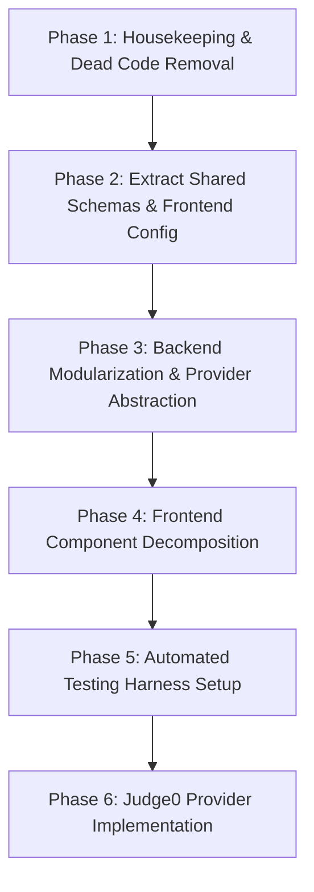
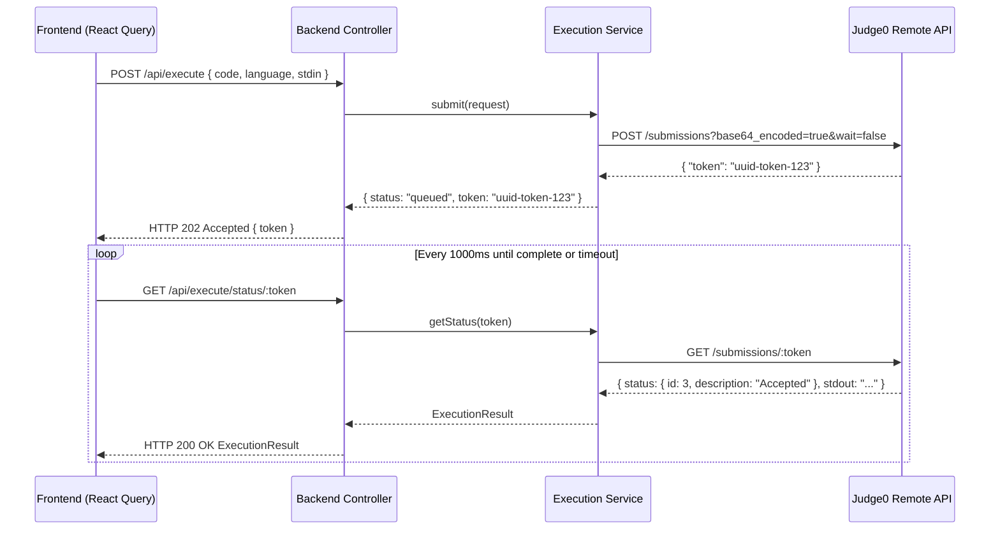

# Codebase Audit & Refactoring Plan: Online Compiler (CodeRunner)

**Document Status**: Prepared by Senior Full-Stack Engineering Review  
**Target Repository**: `RMXN007/Online-Compiler`  
**Purpose**: Comprehensive audit of current codebase, verification of architectural claims, identification of technical debt and security risks, and a phased refactoring plan to prepare for remote code execution (Judge0 on Render).

---

## 1. Executive Summary

A comprehensive, line-by-line audit of the `RMXN007/Online-Compiler` repository was conducted across frontend, backend, configuration, and dependencies.

### Key Conclusions:
1. **Working Core with High Technical Debt**: The application successfully implements a working in-browser code editor (React + CodeMirror 6) and local code execution (Express + `child_process.exec`). However, it carries significant dead weight from boilerplate scaffolding (e.g., Replit, Drizzle ORM, unmounted UI components, and authentication libraries).
2. **Critical Security Vulnerabilities in Local Execution**: The current local runner directly executes un-sandboxed shell commands with the full privileges of the host Node.js process. It allows arbitrary filesystem access, host command execution, process exhaustion, and denial of service.
3. **Ghost Modules & Phantom Dependencies**: 
   - Over **12 production dependencies** (e.g., `passport`, `connect-pg-simple`, `framer-motion`, `ws`, `react-icons`, `date-fns`) are declared in `package.json` but **never imported** anywhere in application code.
   - 38 out of 46 UI components in `client/src/components/ui/` are **unmounted dead code**.
   - A complete database scaffolding (`shared/schema.ts`, `server/storage.ts`, `drizzle.config.ts`) exists for a `users` table that is never queried by any route or UI component.
4. **Platform Coupling & Windows Bugs**: The backend has hardcoded Unix commands (`rm -rf` and `which`) that fail on native Windows command prompts, causing temp folder accumulation and false Python missing warnings.
5. **No Existing Automated Tests**: The codebase has **0 unit, integration, or end-to-end tests**, making refactoring risky without a clear testing harness.

---

## 2. Current Repository Structure

```
Online-Compiler/
├── .ccls-cache/                     # [ORPHAN] C++ language server cache from previous IDE/Replit run
├── .replit                          # [PLATFORM] Replit execution config
├── replit.nix                       # [PLATFORM] Nix environment packages (clang, ccls, gdb, gnumake)
├── replit.md                        # [DOCS] Replit project summary
├── components.json                  # [CONFIG] Shadcn/UI CLI configuration
├── drizzle.config.ts                # [ORPHAN] Drizzle ORM configuration for PostgreSQL
├── main                             # [ORPHAN] Compiled 30KB Linux ELF binary from main.cpp
├── main.cpp                         # [ORPHAN] Standalone C++ "Hello World" source file
├── Makefile                         # [ORPHAN] Makefile targeting main.cpp with clang++
├── package.json                     # [MANIFEST] Dependencies and npm scripts
├── package-lock.json                # [LOCKFILE]
├── postcss.config.js                # [CONFIG] Tailwind/PostCSS configuration
├── tailwind.config.ts               # [CONFIG] Tailwind theme and design tokens
├── tsconfig.json                    # [CONFIG] TypeScript compiler options
├── vite.config.ts                   # [CONFIG] Vite client bundler configuration
├── README.md                        # [DOCS] User documentation
├── ARCHITECTURE.md                  # [DOCS] Technical architecture reference
├── client/
│   ├── index.html                   # HTML entrypoint
│   ├── public/
│   │   └── favicon.png              # Favicon asset
│   └── src/
│       ├── main.tsx                 # Client bootstrap
│       ├── App.tsx                  # Root router, shell layout, LANGUAGES preset definitions
│       ├── index.css                # Global CSS variables & styling
│       ├── components/
│       │   ├── app-sidebar.tsx      # Sidebar navigation & language route links
│       │   ├── code-editor.tsx      # CodeMirror 6 editor wrapper
│       │   ├── theme-toggle.tsx     # Theme switcher button
│       │   └── ui/                  # 46 Shadcn UI component files (38 unused)
│       ├── hooks/
│       │   ├── use-mobile.tsx       # Screen breakpoint detection hook (unused in app)
│       │   ├── use-theme.ts         # Theme hook (localStorage + HTML class toggling)
│       │   └── use-toast.ts         # Toast dispatching hook
│       ├── lib/
│       │   ├── queryClient.ts       # TanStack Query client & apiRequest wrapper
│       │   └── utils.ts             # Tailwind class merging helper (cn)
│       └── pages/
│           ├── editor.tsx           # Primary IDE page (Editor, Output panel, Toolbar actions)
│           ├── snippets.tsx         # Predefined code examples page
│           ├── settings.tsx         # Theme settings and environment info page
│           └── not-found.tsx        # 404 route page
├── server/
│   ├── index.ts                     # Express server setup, request logger, Vite/Static middleware
│   ├── routes.ts                    # REST routes (/api/execute) & local child_process runners
│   ├── static.ts                    # Production static file serving (dist/public)
│   ├── storage.ts                   # [ORPHAN] In-memory user store (MemStorage)
│   └── vite.ts                      # Development Vite middleware integration
├── shared/
│   └── schema.ts                    # [ORPHAN] Drizzle ORM pgTable "users" definition & Zod schema
└── script/
    └── build.ts                     # Production build orchestration (Vite + esbuild)
```

---

## 3. Current Architecture Findings & Verification

We verified the claims in `ARCHITECTURE.md` against the raw source code.

### 3.1 Verified Architectural Facts
1. **Single Express Server**: `server/index.ts` binds port 5000 and serves both Vite/static assets and `/api/execute`.
2. **Local Synchronous Child Process Execution**: In `server/routes.ts`, `POST /api/execute` executes `child_process.exec`, blocks until the command completes or times out, and immediately returns the JSON payload.
3. **Execution Commands**:
   - `javascript`: `node --harmony "code.js"` (10s timeout)
   - `typescript`: `"${tsxBin}" "code.ts"` (15s timeout)
   - `c`: `gcc -O2 -o "code" "code.c" -lm 2>&1` (30s) $\rightarrow$ `"./code"` (10s)
   - `cpp`: `g++ -O2 -o "code" "code.cpp" 2>&1` (30s) $\rightarrow$ `"./code"` (10s)
   - `python`: `which python3 || which python` (3s) $\rightarrow$ `${pythonBin} "code.py"` (10s)
   - `bash`: `bash "code.sh"` (10s)
4. **No Stdin Support**: The code editor UI has no input field, and `server/routes.ts` does not write to the process's standard input pipe.
5. **Output MaxBuffer**: `runCommand` enforces `maxBuffer: 1024 * 1024` (1 MB) and captures standard output and error.

### 3.2 Inaccuracies and Outdated Claims in Existing Documentation
1. **Drizzle ORM & Database Claims**: `README.md` previously instructed running `npm run db:push`. In reality, the database schema is completely orphaned; no route or controller ever connects to PostgreSQL or calls `storage.ts`.
2. **C++ Compiler in Settings UI**: `client/src/pages/settings.tsx` hardcodes `"C++ Compiler": "GCC 13.2.0"`, `"Node.js 20"`, and `"Bash 5.2"`. This is static cosmetic text; the client does not query actual installed compiler versions.
3. **Allowlist in `script/build.ts`**: The build script includes external bundle allowlists for `@google/generative-ai`, `stripe`, `openai`, `nodemailer`, `xlsx`, and `multer`. None of these packages exist in `package.json` or anywhere in the codebase. It was copied verbatim from an unrelated Replit template.

---

## 4. File-by-File Audit

| File Path | Type | Current Status | Issues & Technical Debt | Refactoring Recommendation |
| :--- | :--- | :--- | :--- | :--- |
| `main.cpp` | Root C++ | **Orphan** | Stray file from Replit starter. Unused by server or app. | Remove in cleanup phase. |
| `main` | Root Binary | **Orphan** | Compiled 30KB Linux ELF executable. Stored in git. | Remove in cleanup phase. |
| `Makefile` | Root Build | **Orphan** | Compiles `main.cpp` using `clang++`. Unused by app. | Remove in cleanup phase. |
| `.ccls-cache/` | Root Cache | **Orphan** | Language server cache directory committed accidentally. | Add to `.gitignore` and delete. |
| `drizzle.config.ts` | Config | **Orphan** | Configures PostgreSQL migrations for unused users table. | Remove or quarantine until DB needed. |
| `shared/schema.ts` | Shared Model | **Orphan** | Defines `users` table and `insertUserSchema`. Never used. | Replace with pure API request/response types. |
| `server/storage.ts` | Backend Store | **Orphan** | Implements `MemStorage` for user CRUD. Never called. | Remove. |
| `server/routes.ts` | Backend Route | **Active (Overloaded)** | Combines API routing, input validation, temp directory management, and 6 language CLI runners in 174 lines. | Split into Controller, Execution Service, and Local Provider. |
| `server/index.ts` | Backend Server | **Active** | Sets up Express, JSON middleware, custom logging, and static/Vite loading. Clean, but port binding was tweaked for Windows. | Keep; extract request logger to middleware file. |
| `server/vite.ts` | Backend Tooling | **Active (Dev)** | Integrates Vite HMR middleware. Works as intended. | Keep as-is. |
| `server/static.ts` | Backend Tooling | **Active (Prod)** | Serves `dist/public`. Works as intended. | Keep as-is. |
| `script/build.ts` | Build Script | **Active (Bloated)** | Hardcodes an allowlist with 15+ packages not in the project (OpenAI, Stripe, etc.). | Prune allowlist to actual project dependencies. |
| `client/src/App.tsx` | Frontend Root | **Active (Overloaded)** | Combines routing, layout, and a massive 220-line `LANGUAGES` dictionary with boilerplate code. | Extract `LANGUAGES` dictionary into dedicated configuration file. |
| `client/src/pages/editor.tsx` | Frontend Page | **Active (Overloaded)** | Manages code state, output state, panel heights, download/copy handlers, and execution mutation in 316 lines. | Extract OutputPanel and EditorToolbar into subcomponents. |
| `client/src/pages/snippets.tsx` | Frontend Page | **Active** | Predefined code snippet cards. Works well. | Move snippet dataset to a separate config file. |
| `client/src/pages/settings.tsx` | Frontend Page | **Active** | Theme toggles and hardcoded system info. | Replace fake system info with real API diagnostics or disclaimer. |
| `client/src/components/code-editor.tsx` | Frontend Component | **Active** | CodeMirror 6 engine wrapper. Clean compartment isolation. | Keep; add resize handler and tab customization. |
| `client/src/components/app-sidebar.tsx` | Frontend Component | **Active** | Sidebar navigation. Duplicates language list with `App.tsx`. | Share language definition from central config. |
| `client/src/components/theme-toggle.tsx` | Frontend Component | **Active** | Clean theme switcher button. | Keep as-is. |
| `client/src/components/ui/*.tsx` | Frontend UI | **8 Used / 38 Unused** | 46 UI components generated by shadcn. 38 are completely unreferenced. | Keep only used components; remove dead components to reduce bundle overhead. |
| `client/src/hooks/use-theme.ts` | Frontend Hook | **Active** | Manages `light`/`dark` class on root HTML. | Keep as-is. |
| `client/src/hooks/use-toast.ts` | Frontend Hook | **Active** | Toast state manager. | Keep as-is. |
| `client/src/hooks/use-mobile.tsx` | Frontend Hook | **Unused** | Detects window resize `< 768px`. Not imported. | Delete or retain only if responsive drawer is added. |
| `client/src/lib/queryClient.ts` | Frontend Client | **Active** | TanStack Query config & `apiRequest` wrapper. | Keep; adapt for async execution polling. |
| `client/src/lib/utils.ts` | Frontend Utility | **Active** | `cn()` helper (`clsx` + `twMerge`). | Keep as-is. |

---

## 5. Unused Dependencies & Dead Configuration

### 5.1 Unused Production Dependencies in `package.json`

The following 16 dependencies are installed in `node_modules` and listed under `dependencies`, but have **zero imports** in the entire codebase:

1. `@hookform/resolvers` (Form validation resolver)
2. `@jridgewell/trace-mapping` (Source map tooling)
3. `connect-pg-simple` (PostgreSQL session store)
4. `date-fns` (Date utility library)
5. `express-session` (Session middleware)
6. `framer-motion` (Animation library)
7. `memorystore` (In-memory session store)
8. `next-themes` (Unused; app uses custom `use-theme.ts`)
9. `passport` (Authentication framework)
10. `passport-local` (Local auth strategy)
11. `pg` (PostgreSQL client)
12. `react-icons` (Unused; app uses `lucide-react`)
13. `tw-animate-css` (CSS animation helper)
14. `ws` (WebSocket server)
15. `zod-validation-error` (Unused formatting helper)
16. Unused Radix UI libraries imported only by dead UI components (`@radix-ui/react-accordion`, `@radix-ui/react-alert-dialog`, `@radix-ui/react-aspect-ratio`, `@radix-ui/react-avatar`, `@radix-ui/react-checkbox`, `@radix-ui/react-context-menu`, `@radix-ui/react-hover-card`, `@radix-ui/react-menubar`, `@radix-ui/react-navigation-menu`, `@radix-ui/react-popover`, `@radix-ui/react-progress`, `@radix-ui/react-radio-group`, `@radix-ui/react-slider`, `@radix-ui/react-switch`, `@radix-ui/react-toggle-group`, `@radix-ui/react-toggle`).

### 5.2 Unused DevDependencies
- `@types/connect-pg-simple`
- `@types/express-session`
- `@types/passport`
- `@types/passport-local`
- `@types/ws`
- `drizzle-kit` (Database migration CLI)

### 5.3 Dead / Orphaned Configuration Files
- `drizzle.config.ts` (Drizzle ORM configuration)
- `Makefile` (Standalone C++ makefile)
- `main.cpp` and binary `main`

---

## 6. Security and Reliability Findings

### 6.1 Critical Security Vulnerabilities (Local Execution Engine)

```
[Attacker HTTP Client]
       │  POST /api/execute
       │  { language: "bash", code: "rm -rf /" }  OR
       │  { language: "javascript", code: "process.mainModule.require('child_process').execSync('cat /etc/passwd')" }
       ▼
[Express Server (server/routes.ts)]
       │  writeFile(join(tmpdir(), "code.sh"), code)
       ▼
[Host Shell: child_process.exec]  <─── ZERO SANDBOXING, FULL HOST PRIVILEGES
```

1. **Unrestricted Remote Code Execution (RCE)**:
   - There is no containerization, seccomp filtering, or privilege dropping.
   - Any user can read backend environment variables, inspect local source code, or execute malicious binaries.
2. **Denial of Service (DoS) via Fork Bombs**:
   - Running `:(){ :|:& };:` in Bash or `while(true) fork()` in C++ will instantly exhaust host process limits and crash the server.
3. **Resource Exhaustion**:
   - `maxBuffer` is capped at 1 MB, but there is no memory ceiling (e.g., a script allocating 8 GB of RAM will trigger an Out-Of-Memory crash on the host).

### 6.2 Platform Reliability & Portability Bugs
1. **Windows Temp Cleanup Failure**:
   - `server/routes.ts` L32 executes `rm -rf "${dir}"`.
   - On native Windows Command Prompt / PowerShell, `rm` is not recognized. The `try/catch` block suppresses the error, causing orphaned folders (`coderunner-*`) to permanently accumulate in `%TEMP%`.
   - **Fix**: Use Node's built-in `fs.promises.rm(dir, { recursive: true, force: true })`.
2. **Windows Python Resolution Failure**:
   - `server/routes.ts` L91 executes `which python3 || which python`.
   - `which` is a POSIX binary and does not exist on Windows (`where.exe` is the Windows equivalent). This causes the server to report that Python is not installed even when it is.
3. **Missing Stdin Handling**:
   - Any program executing `std::cin`, `scanf`, or `input()` waits indefinitely for user input and terminates only after the 10-second timeout.

---

## 7. Proposed Folder Structure

The proposed folder structure introduces modular separation of concerns without over-engineering:

```
Online-Compiler/
├── client/                               # Frontend Single Page Application
│   ├── index.html
│   ├── public/
│   │   └── favicon.png
│   └── src/
│       ├── main.tsx
│       ├── App.tsx                       # Clean router & shell layout
│       ├── index.css
│       ├── config/                       # Centralized frontend configurations
│       │   ├── languages.config.ts       # Unified language definitions & starter templates
│       │   └── snippets.config.ts        # Predefined code snippet dataset
│       ├── components/                   # Shared UI primitives
│       │   ├── layout/
│       │   │   ├── app-sidebar.tsx       # Sidebar navigation
│       │   │   └── theme-toggle.tsx      # Dark/light theme switcher
│       │   ├── editor/
│       │   │   ├── code-editor.tsx       # CodeMirror 6 engine
│       │   │   ├── editor-toolbar.tsx    # Run, reset, copy, download actions
│       │   │   └── output-panel.tsx      # Terminal output & telemetry display
│       │   └── ui/                       # Only ACTIVE Shadcn components (8 files)
│       │       ├── badge.tsx
│       │       ├── button.tsx
│       │       ├── card.tsx
│       │       ├── scroll-area.tsx
│       │       ├── separator.tsx
│       │       ├── sidebar.tsx
│       │       ├── toast.tsx
│       │       ├── toaster.tsx
│       │       └── tooltip.tsx
│       ├── hooks/                        # Custom React hooks
│       │   ├── use-theme.ts
│       │   └── use-toast.ts
│       ├── lib/                          # Client utilities & API callers
│       │   ├── api.ts                    # Dedicated API client functions
│       │   ├── queryClient.ts
│       │   └── utils.ts
│       └── pages/                        # Page views
│           ├── editor-page.tsx
│           ├── snippets-page.tsx
│           ├── settings-page.tsx
│           └── not-found-page.tsx
├── server/                               # Backend Express Application
│   ├── index.ts                          # Express bootstrap & HTTP listener
│   ├── app.ts                            # Express app configuration & middleware pipeline
│   ├── config/
│   │   └── env.config.ts                 # Validated environment configuration (PORT, timeouts)
│   ├── controllers/
│   │   └── execution.controller.ts       # Request validation & HTTP response mapping
│   ├── routes/
│   │   ├── index.ts                      # Top-level API router aggregator
│   │   └── execution.routes.ts           # /api/execute routes
│   ├── services/
│   │   ├── execution.service.ts          # Execution orchestration service
│   │   └── providers/                    # Execution Provider Abstraction
│   │       ├── execution-provider.interface.ts # Common execution interface
│   │       ├── local-execution.provider.ts     # Current child_process runner (Refactored)
│   │       └── judge0-execution.provider.ts    # Future Judge0 remote client
│   ├── middleware/
│   │   ├── error-handler.middleware.ts   # Centralized error handler
│   │   └── request-logger.middleware.ts  # Structured API request logging
│   └── utils/
│       ├── command-runner.ts             # Safe child_process wrapper
│       └── temp-dir.ts                   # Cross-platform fs.rm temp directory manager
├── shared/                               # Shared Between Frontend and Backend
│   ├── types/
│   │   └── execution.types.ts            # Common ExecutionRequest & ExecutionResult interfaces
│   └── validation/
│       └── execution.schema.ts           # Zod schema for code execution payloads
├── script/
│   └── build.ts                          # Cleaned production build script
├── package.json
├── tsconfig.json
├── vite.config.ts
└── tailwind.config.ts
```

---

## 8. File Movement and Refactoring Table

| Current Location | Target Location | Action | Reason |
| :--- | :--- | :--- | :--- |
| `main.cpp`, `main`, `Makefile` | *(Deleted)* | Remove | Stray files from Replit C++ template; completely unused. |
| `.ccls-cache/` | *(Deleted / gitignored)* | Remove | C++ language server cache files mistakenly tracked. |
| `shared/schema.ts` | `shared/types/execution.types.ts` & `shared/validation/execution.schema.ts` | Split & Replace | Delete unused `users` Drizzle schema; house pure API execution types and Zod schemas. |
| `server/storage.ts` | *(Deleted)* | Remove | Unused mock user store with no consumer. |
| `drizzle.config.ts` | *(Deleted)* | Remove | No database operations exist in the online compiler. |
| `server/routes.ts` | `server/controllers/execution.controller.ts`<br>`server/services/execution.service.ts`<br>`server/services/providers/local-execution.provider.ts`<br>`server/routes/execution.routes.ts` | Split & Modularize | Disentangles monolithic 174-line file into distinct routes, controller, service, and provider layers. |
| `server/index.ts` | `server/index.ts` & `server/middleware/request-logger.middleware.ts` | Extract | Keeps server startup clean and isolates request logging logic. |
| `client/src/App.tsx` (lines 16-242) | `client/src/config/languages.config.ts` | Extract | Extracts 220 lines of hardcoded language starter code out of the root UI file. |
| `client/src/pages/snippets.tsx` (lines 7-62) | `client/src/config/snippets.config.ts` | Extract | Separates snippet content data from rendering UI. |
| `client/src/pages/editor.tsx` (Toolbar & Output) | `client/src/components/editor/editor-toolbar.tsx`<br>`client/src/components/editor/output-panel.tsx` | Split | Reduces `editor.tsx` from 316 lines to a concise, readable container page. |
| 38 unused files in `client/src/components/ui/` | *(Deleted)* | Remove | Prunes ~2,500 lines of dead code that are never rendered. |

---

## 9. Phased Migration Plan

To maintain stability and avoid breaking changes, the refactoring must follow a strict sequential, phased approach.



### Phase 1: Housekeeping & Dead Code Removal
- **Goal**: Clean the workspace of non-functional artifacts without modifying any active application logic.
- **Actions**:
  1. Delete stray root artifacts: `main.cpp`, `main`, `Makefile`, and `.ccls-cache`.
  2. Add `.ccls-cache/` to `.gitignore`.
  3. Clean up the unused allowlist entries in `script/build.ts` (e.g., Stripe, OpenAI, Multer).
- **Verification**: Run `npm run check` and `npm run build` to ensure build succeeds.

### Phase 2: Shared Contracts & Frontend Configuration Extraction
- **Goal**: Decouple static data and establish single sources of truth.
- **Actions**:
  1. Create `shared/types/execution.types.ts` and `shared/validation/execution.schema.ts`.
  2. Move the `executeSchema` from `server/routes.ts` into `shared/validation/execution.schema.ts`.
  3. Create `client/src/config/languages.config.ts` and migrate the `LANGUAGES` dictionary from `App.tsx`.
  4. Create `client/src/config/snippets.config.ts` and migrate the snippet array from `snippets.tsx`.
- **Verification**: Verify that navigating between `/`, `/c`, `/cpp`, `/python`, `/bash`, and `/snippets` still renders all default templates and snippets correctly.

### Phase 3: Backend Modularization & Cross-Platform Fixes
- **Goal**: Introduce the `ExecutionProvider` abstraction and fix Windows platform bugs.
- **Actions**:
  1. Create `server/services/providers/execution-provider.interface.ts`.
  2. Implement `server/services/providers/local-execution.provider.ts`.
  3. Replace `rm -rf "${dir}"` with native `fs.promises.rm(dir, { recursive: true, force: true })`.
  4. Fix Python detection to handle Windows environments (`process.platform === "win32"` using `where` or fallback).
  5. Connect `server/controllers/execution.controller.ts` and `server/routes/execution.routes.ts`.
- **Verification**: Test running JavaScript, TypeScript, C, C++, Python, and Bash code via `POST /api/execute`.

### Phase 4: Frontend Component Decomposition
- **Goal**: Break down `client/src/pages/editor.tsx` into modular sub-components.
- **Actions**:
  1. Extract `EditorToolbar` (`client/src/components/editor/editor-toolbar.tsx`).
  2. Extract `OutputPanel` (`client/src/components/editor/output-panel.tsx`).
  3. Remove unreferenced UI components from `client/src/components/ui/`.
- **Verification**: Verify Run, Reset, Clear, Download, Copy, and Output collapsibility in browser.

### Phase 5: Testing Strategy Implementation
- **Goal**: Introduce automated regression test coverage before integrating Judge0.
- **Actions**:
  1. Set up Vitest (`vitest`) for unit tests and Supertest (`supertest`) for backend API integration tests.
  2. Write unit tests for schema validation, language configurations, and execution provider contracts.
  3. Write integration tests for `POST /api/execute`.

---

## 10. Testing Strategy

Currently, the repository has no automated tests. The following test suites must be introduced during refactoring:

### 10.1 Automated Test Suites to Implement

```
tests/
├── unit/
│   ├── shared/
│   │   └── execution-schema.test.ts      # Validates Zod schema constraints (min/max/enum)
│   ├── server/
│   │   ├── local-provider.test.ts        # Mocks child_process and verifies command creation
│   │   └── temp-dir.test.ts              # Validates cross-platform creation & deletion
│   └── client/
│       ├── languages-config.test.ts      # Ensures all languages have valid extensions and templates
│       └── utils.test.ts                 # Tests cn() utility
└── integration/
    └── api/
        └── execute.test.ts               # Supertest tests against /api/execute with mock provider
```

### 10.2 Manual Test Checklist for Each Language

| Language | Test Case | Expected Behavior |
| :--- | :--- | :--- |
| **JavaScript** | `console.log(2 + 2);` | Output: `4\n`, Exit Code: `0`, stderr: empty |
| **TypeScript** | `const x: number = 10; console.log(x);` | Output: `10\n`, Exit Code: `0`, stderr: empty |
| **C** | `#include <stdio.h>\nint main(){printf("C OK");}` | Output: `C OK`, Exit Code: `0`, stderr: empty |
| **C++** | `#include <iostream>\nint main(){std::cout<<"CPP OK";}` | Output: `CPP OK`, Exit Code: `0`, stderr: empty |
| **Python** | `print("PY OK")` | Output: `PY OK\n`, Exit Code: `0`, stderr: empty |
| **Bash** | `echo "SH OK"` | Output: `SH OK\n`, Exit Code: `0`, stderr: empty |
| **Any** | Infinite loop (e.g. `while(1){}`) | Terminated after timeout (10s), non-zero exit code |
| **Syntax Error**| Missing semicolon or syntax error | Exit code `1`, diagnostic details rendered in `stderr` |

---

## 11. Judge0 Integration Preparation

### 11.1 The `ExecutionProvider` Interface

To allow switching between local execution (for development) and Judge0 (for hosted production on Render), we define a strict execution provider contract:

```typescript
// shared/types/execution.types.ts

export type SupportedLanguage = 
  | "javascript" 
  | "typescript" 
  | "c" 
  | "cpp" 
  | "python" 
  | "bash";

export interface ExecutionRequest {
  code: string;
  language: SupportedLanguage;
  stdin?: string;
}

export interface ExecutionResult {
  stdout: string;
  stderr: string;
  exitCode: number;
  executionTime: number; // in milliseconds
  language: SupportedLanguage;
  memory?: number;       // in kilobytes (supported by Judge0)
  statusDescription?: string; // e.g. "Accepted", "Time Limit Exceeded"
}

// server/services/providers/execution-provider.interface.ts
export interface ExecutionProvider {
  name: string;
  isAvailable(): Promise<boolean>;
  execute(request: ExecutionRequest): Promise<ExecutionResult>;
}
```

### 11.2 Handling Async Submission & Polling

Because remote code execution in Judge0 can take 1 to 5 seconds depending on queue depth, the provider architecture should support both synchronous response (for local execution) and async token-based polling (for Judge0):



---

## 12. Risks and Recommendations

| Risk | Impact | Mitigation Strategy |
| :--- | :--- | :--- |
| **Breaking Language Execution During Split** | High | Abstract `server/routes.ts` into `local-execution.provider.ts` with zero logic changes before modifying commands. |
| **Path/Import Resolution Breakages** | Medium | Use TypeScript path aliases (`@/` and `@shared/`) already configured in `tsconfig.json`. |
| **Judge0 API Key Exposure** | Critical | Keep Judge0 API credentials exclusively on the Express backend (`process.env.JUDGE0_API_KEY`). Never expose keys to client bundles. |
| **Orphaned Temp Files on Windows** | Medium | Replace `rm -rf` shell calls immediately with Node's native cross-platform `fs.promises.rm`. |
| **Rate Limiting & API Quota Depletion** | High | When deploying Judge0, implement `express-rate-limit` on the backend to prevent abuse from depleting RapidAPI quotas. |

---

## Top 5 Priority Recommendations

Before executing the full refactoring plan, perform these five high-impact, non-breaking steps first:

1. **Delete Dead Project Artifacts**: Safely remove `main.cpp`, `main`, `Makefile`, and `.ccls-cache` from the repository root, and remove orphaned package names from `script/build.ts`.
2. **Fix Cross-Platform Temp Cleanup**: Replace `await runCommand('rm -rf "${dir}"')` with native `await fs.promises.rm(dir, { recursive: true, force: true })` in `server/routes.ts` to prevent disk bloat on Windows.
3. **Extract Shared Execution Schemas**: Create `shared/types/execution.types.ts` and `shared/validation/execution.schema.ts` to establish a single contract between frontend and backend.
4. **Extract Language Boilerplate from `App.tsx`**: Move the 220-line `LANGUAGES` dictionary into `client/src/config/languages.config.ts` to declutter the root routing component.
5. **Establish the `ExecutionProvider` Interface**: Create the provider abstraction and wrap the existing `server/routes.ts` logic into a `LocalExecutionProvider` class, paving a clear, zero-risk pathway for the upcoming Judge0 integration.
